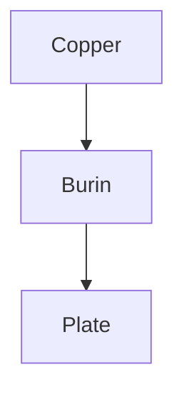

This page exercises every construct the renderer knows, set the way the plate will carry it: a drop cap, generous leading, rubricated heads, and rules where a printer would have used them. Here is *emphasis*, **strong words in small capitals**, `inline code`, ~~a struck line~~, and [a link inside the site](/posts) beside [one that leaves](https://example.com).[^1]

## A section head

Plain paragraphs follow one another with an even rhythm. A footnote reference sits in rubric.[^long] Hard line breaks hold,  
like this one,  
and soft ones fold into the measure.

### A smaller head, in italic

#### And the smallest, lettered

> A quotation sits indented behind a single hairline, set in italic so it reads as another voice.

> [!NOTE]
> Notes carry a manicule and a rubric label.

> [!TIP] Tips can start on the same line as the marker.

> [!IMPORTANT]
> Important matters take the section mark.

> [!WARNING]
> Warnings take the dagger.

> [!CAUTION]
> Cautions take the double dagger, and can hold **strong** and `code` too.

- An unordered list
- With a second item that runs long enough to wrap onto a following line, so the hanging indent shows
  - A nested item
    - Nested again
- [x] A task that is done
- [ ] A task still open

1. Ordered lists count in rubric
2. And keep counting
   1. Even when nested

---

```rust
fn main() {
    let plate = Plate::engrave("burin", 0x5eed);
    println!("{plate:?} is a very long line that should scroll horizontally rather than wrap, because code keeps its shape");
}
```



| Tool | Use | Weight |
|:-----|:---:|------:|
| Burin | engraving | 40 g |
| Scraper | *correcting* | 55 g |
| Burnisher | polishing | 60 g |

<div class="legacy">
<p>An old HTML block survives as plain text &amp; nothing more.</p>
</div>

<ff-reveal label="What lies under the fold">
Revealed text is ordinary markdown: *emphasis*, a [link](/now), and lists.

- one
- two
</ff-reveal>

<ff-tuner></ff-tuner>

<ff-nothing></ff-nothing>

<ff-orrery speed="slow"></ff-orrery>

A figure from a Farfield blob, with its caption from the alt text:


A `blob://` figure (through the Worker's image proxy; a coloured plate until it loads):


A video blob shows its poster with a lettered play:


[^1]: The first footnote.
[^long]: A longer footnote that explains something at more length than the margin would allow.
